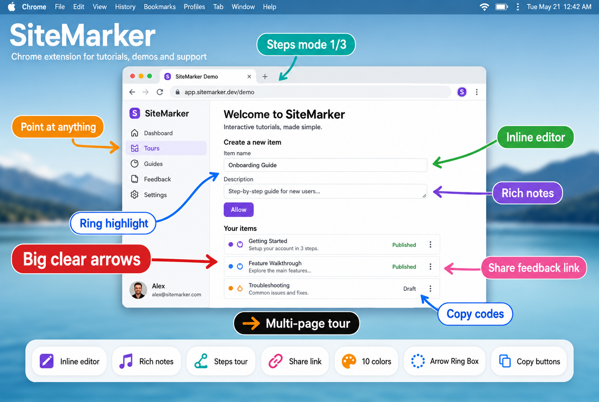

# SiteMarker

[](https://github.com/stackhamza/SiteMarker-Chrome-Extension)

**Point at anything on a web page** with clear arrows, rings, boxes and signs. Built for tutorials, demos, onboarding and support.

No accounts. No telemetry. Everything stays in your browser.

**Repo:** [github.com/stackhamza/SiteMarker-Chrome-Extension](https://github.com/stackhamza/SiteMarker-Chrome-Extension)

---

## Features

- 🎯 **Point at anything** — click any element (or drag an area) and place a marker on it
- ➡️ **Arrow / Ring / Box** — three highlight styles, multiple arrow shapes (curve, straight, zigzag, spiral)
- 🎨 **10 colours** — red, orange, yellow, green, teal, blue, purple, pink, black, white
- ✏️ **Sign text** — custom label on every marker; use `{{code}}` for a one-click copy button
- 📝 **Rich notes** — free-form multi-line note under the marker
- 🖱️ **Inline editor** — click any text on the page → places a pointer and lets you edit that page text
- 🔢 **Steps mode** — show one marker at a time with Next / Prev and auto-scroll
- 🗺️ **Multi-page tour** — capture each marker as a section; build tours across pages; share one link
- 🔗 **Share for feedback** — private link or downloadable HTML so others can review without the extension
- ✋ **Drag & retarget** — drag the marker to move it; drag the arrowhead to point somewhere else
- 🔍 **Global sizes** — text and arrow size sliders update all markers without moving them
- ⌨️ **Shortcuts** — `Alt+Shift+A` pick target · `Alt+Shift+X` clear all
- 🔒 **Privacy-first** — `activeTab`, `scripting`, `storage`, `contextMenus` only — nothing leaves your machine

---

## Install (developer mode)

1. Clone this repo:
   ```bash
   git clone https://github.com/stackhamza/SiteMarker-Chrome-Extension.git
   cd SiteMarker-Chrome-Extension
   ```
2. Open Chrome → `chrome://extensions`
3. Enable **Developer mode** (top right)
4. Click **Load unpacked** and select this folder

> Requires Chrome 111+ (Manifest V3).

---

## Quick start

1. Open any normal website (not `chrome://` pages).
2. Click the **SiteMarker** toolbar icon.
3. Style your marker (colour, arrow/ring/box, text).
4. Press **Pick a target** and click something on the page.
5. Drag the marker or arrowhead to refine; double-click the marker to edit.

### Inline editor

1. Popup → **Behavior** → enable **Inline editor**.
2. Click any text on the page.
3. A pointer is added and an editor opens for **sign label** + **page text**.
4. Save — the page text updates and the arrow keeps pointing at it.

### Steps & tours

- **Steps mode** (Behavior): one marker at a time on the current page.
- **Add sections to tour**: captures each marker as its own viewport section.
- Open another page, add more sections, then **Share tour** for one link with Next / Previous.

### Share

Place markers → **Share**. SiteMarker captures each section, opens a feedback page, and copies a private link. Recipients can copy text and codes; use **Download page to send** for a self-contained HTML file that works without the extension.

---

## Keyboard shortcuts

| Shortcut | Action |
|----------|--------|
| `Alt+Shift+A` | Pick a target |
| `Alt+Shift+X` | Clear all markers on this page |

Change them at `chrome://extensions/shortcuts`.

Right-click the page for the same actions via the context menu.

---

## Project structure

```
SiteMarker-Chrome-Extension/
├── manifest.json      # MV3 manifest
├── background.js      # Service worker (commands, context menu, inject)
├── content.js         # Page overlay, picker, steps, inline editor, capture helpers
├── core.js            # Geometry, rendering, defaults (shared)
├── popup.html/css/js  # Extension popup UI
├── share.html/js      # Feedback / share page
├── viewer.js          # Shared viewer for share + downloadable HTML
├── assets/            # README thumbnail
├── icons/             # 16, 32, 48, 128
├── LICENSE            # MIT
└── README.md
```

---

## Permissions

| Permission | Why |
|------------|-----|
| `activeTab` | Draw on the current tab; screenshot when you press Share |
| `scripting` | Inject the overlay only when you ask (pick / share / inline mode) |
| `storage` | Save your settings and local shares/tours |
| `contextMenus` | Right-click “point at something” / “remove all” |

Nothing is sent to a server. Shares are stored in `chrome.storage.local` on your machine (last 8 kept).

---

## Development

1. Load unpacked as above.
2. After code changes: `chrome://extensions` → refresh the extension card, then reload the web page you are testing.
3. Popup and content scripts are plain JS — no build step.

---

## Tips

- Wrap text in `{{like this}}` to get a copy chip on the marker.
- **Reset** in the popup restores all defaults (every toggle off).
- Resizing text/arrow globally never moves markers you already placed.
- Esc on the page clears selection / cancels pick; clicking a marker’s × dismisses that marker.


---

## Credits

Icon glyphs for copy/check/close follow the Feather style (MIT).
